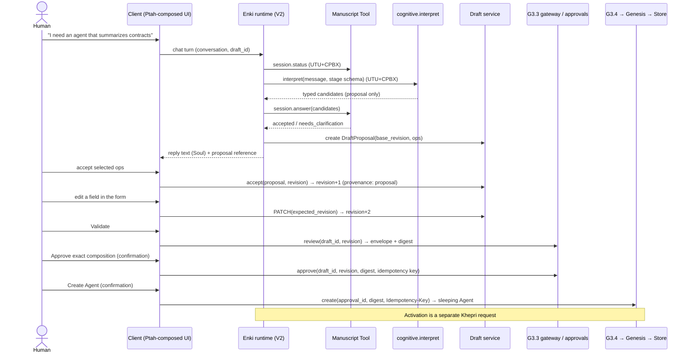

# ENKI-1.0 Architecture: Ptah, Manuscript and the Shared Agent Draft

**Status:** **Approved with conditions** on 2026-10-30 ([ADR-0003](architecture/decisions/ADR-0003-enki-1-0-ptah-manuscript-shared-draft.md)).
Architecture only — **nothing here is implemented**; every milestone is **Planned**.
Proposed 2026-10-30 (ENKI-1.0-A) on `feature/ops-v2` over `828321f` with uncommitted
G3.1–G3.4 and DEV-0.1/0.2. §0 records the approval and where it supersedes §1–§11; the
proposal text below is preserved for history.
**Audience:** CAOS architects and engineers reviewing the path to a fully functional Enki.
**Scope:** contracts and an incremental plan for making Enki a Cognitive Agent that
interviews a human, maintains one shared Agent draft and hands an exactly reviewed
definition to the existing G3.3 approval and G3.4 Genesis creation. Activation
provisioning for created Agents (e.g. Nabu) is designed separately (§9).

Evidence labels: **[existing]** observed in source; **[proposed]** this design.

## 0. Approval record (2026-10-30)

### 0.1 Approved refinements that supersede the proposal

| Topic | Proposal (§) | Approved decision (supersedes where different) |
| --- | --- | --- |
| Ptah storage | "own append-only interface package store" (§2.1) | Append-only storage **only for verified, published canonical packages**; requester projections are **not stored** (§2.4 `RequesterProjection` is computed, optionally cached) |
| Ptah composition timing | Open decision 3 (§11) | **Hybrid**: rebuild canonical packages on definition/dependency change; resolve or cache requester views on request |
| Ptah interactions | §2.5 | Unchanged and confirmed: registered identifiers only; backend resolves bindings and rechecks UTU before CPBX |
| Manuscript predicates | "closed, deterministic language" (§3.1) | Additionally **type-checked with bounded evaluation** |
| Draft and creation | §4.2 "on completion the draft becomes consumed" | Clarified: **a later draft revision never invalidates an already committed or in-flight G3.4 creation**; it only makes earlier reviews inapplicable to the new revision |
| Approval by reference | §4.2 `{draft_id, revision}` | Approval references **draft ID, revision and review digest**, with server-side revalidation |
| Enki grants | §7.2 four new grants | Approved **subject to contract review**; no unrestricted Store, creation, approval or draft-write grants |
| Enki turn | §7.7 "bounded, deterministic step plan" | **Bounded, retry-safe and observable** turn sequence |
| Reasoning | Open decision 8 | **General reusable CAOS capability** with strict typed I/O; proposals only; no unrestricted persistence |
| `submission_enabled` | §7.3 / ROLE-MIG step | Remove **only in a later implementation milestone** with regression coverage; no change now |
| Seshat events | §6 lists four new event types | **Provisional only**: review the existing taxonomy first; audit consequential transitions/decisions, never keystrokes or renders; identifiers, revisions, digests and causation only |
| Sequence | §8 (single DRAFT step, Ptah last) | Superseded by §0.2 |

### 0.2 Approved implementation sequence

1. **DRAFT-0.1** — Durable authoritative draft. **Implemented, uncommitted** (2026-10-30;
   [Agent Drafts](AGENT_DRAFTS.md)); no client uses it yet.
2. **DRAFT-0.2** — Proposals, provenance and human acceptance. **DRAFT-0.2A accepted
   with conditions and closed out, uncommitted** ([Agent Drafts §8–§9](AGENT_DRAFTS.md)):
   Enki's approved, scoped `agent.draft.propose@1.0.0` capability and bounded claim
   recovery. **DRAFT-0.2B implemented, uncommitted** ([Agent Drafts §11](AGENT_DRAFTS.md)):
   requester-scoped listing, exact-revision review, approval binding with freeze, reopen,
   confirmed consumption, fork, and the Enki form on the server draft (no tabs; the
   conversation is not connected).
3. **MANUSCRIPT-0.1** — Registry and deterministic Tool runtime. **Implemented,
   uncommitted** ([Manuscripts](MANUSCRIPTS.md)): versioned registry with pinned published
   fingerprints, deterministic runtime, durable sessions and
   `agent_creation_interview@1.0.0`; **MANUSCRIPT-0.1A** exposes it to Enki only through
   the approved, scoped `manuscript.session.*@1.0.0` signals (no trusted line, no route).
   **CATALOG-0.1** next. Items 4–9 Planned.
4. **CATALOG-0.1** — Requester-scoped catalog capability.
5. **REASONING-0.1** — General bounded reasoning capability.
6. **ENKI-1.0-B** — Soul + Manuscript + reasoning + shared draft.
7. **PTAH-0.1** — Interface composition and integrity foundations.
8. **PTAH-0.2** — Enki form/conversation composition and client integration, including
   multi-interface tabs and label resolution (§0.4–§0.6).
9. **ENKI-1.0** — Full governed interview-to-Agent-creation acceptance.

Condition: Ptah's core **component and interaction contracts must be designed before
ENKI-1.0-B** is implemented. Nabu activation provisioning (§9) is a separate milestone; no
automatic grants or activation.

### 0.3 Open questions flagged for review (items 1–7 open; 8–9 resolved)

1. **Approval-by-reference milestone.** §8 placed it in DRAFT-0.2; the approved
   DRAFT-0.2 is "proposals, provenance and human acceptance". Decide whether approval by
   `{draft_id, revision, review_digest}` lands in DRAFT-0.1 (draft as source of truth) or
   DRAFT-0.2.
2. **`submission_enabled` removal milestone.** "A later implementation milestone" is
   unspecified; ENKI-1.0-B (where the Role changes) is the natural candidate.
3. **Ptah contract-design gate.** Whether the pre-ENKI-1.0-B contract design is a
   separate documentation milestone (e.g. PTAH-0.0) or part of ENKI-1.0-B's entry criteria.
4. **Draft revision auditing.** Which draft revisions are "consequential" for Seshat
   (e.g. accepted proposals and review/approval-bound revisions vs. every form save).
5. **Draft lifecycle after creation.** Whether a consumed draft may continue to be edited
   (forking a new draft) or becomes read-only.
6. **Reasoning capability name and owner.** The proposal used `cognitive.interpret@1.0.0`;
   confirm the identifier and its provider citizen/service.
7. **Ptah principal and capability grants.** Which principals may invoke
   `interface.compose`/`interface.validate`/`interface.project`, and whether Genesis
   invokes `interface.validate` before Store in PTAH-0.1 or later.
8. ~~**Tab labels source (§0.4).**~~ **Resolved 2026-10-30** — see §0.5 (registered
   component default, optional declaration override, deterministic fallback).
9. ~~**Navigation milestone.**~~ **Resolved 2026-10-30** — see §0.6 (PTAH-0.2).

### 0.4 Approved decision — multi-interface Agent navigation (2026-10-30)

**Status: Approved architectural decision, implementation pending.** Applies to the
initial CAOS Client and the Ptah interface composition protocol.

- An Agent with **one** authorized GUI interface renders it **directly** (no tabs).
- An Agent with **multiple** authorized GUI interfaces uses **tabs**.
- Tab **order and labels come from registered GUI declarations**; the Agent's declared
  **default** determines the initial tab.
- Switching tabs **preserves** the underlying draft, conversation and operation state.
- Unauthorized interfaces are not exposed; execution still requires fresh UTU
  authorization (tabs are presentation, never authority).
- The initial navigation component **reuses the existing shadcn/ui Tabs**
  (`caos-client/src/components/ui/tabs.tsx`). No Agent-specific tab logic and no new
  navigation system.
- Ptah will eventually own navigation composition; tabs remain the **default template**
  until an alternative is explicitly designed.

Resulting behavior for current Agents (from their effective GUI declarations): **Enki** —
tabs, *Agent Configuration* (`form:agent_configuration`, default) first, *Conversation*
(`chat:conversation`) second; **Thoth** and **Nabu** — a single `chat:conversation`
interface rendered without tabs.

Current client behavior [existing], for migration: `/v2/forms/{agentId}` renders only the
default form component and links to Conversation at a separate route
(`/v2/conversations?agent=…`), so state is not shared across interfaces. Implementation
must host an Agent's interfaces in one view (keeping each mounted or lifting their state)
so tab switches do not discard draft, conversation or operation state; DRAFT-0.1's
server-authoritative draft supports this.

Label source and implementing milestone: resolved in §0.5 and §0.6.

### 0.5 Approved decision 8 — interface tab labels (2026-10-30)

**Status: Approved architectural decision, implementation pending.**

- **Default labels belong to the versioned UI Component Registry** (Ptah's Component
  registry, §2.2 — proposed, not implemented): each registered component version declares
  its default presentation label.
- An Agent's GUI declaration **may** provide an optional **presentation-label override**
  per declared interface.
- **Resolution order:** declaration override → registered component default →
  deterministic fallback. The fallback is derived only from declaration data (for
  example the component `type`/`key`), so the same declaration always yields the same
  label; its exact rule is fixed in the Ptah component contract design.
- Labels are **presentation metadata only**: they never affect Agent or interface
  identity, the review digest's authority, UTU authorization, CPBX binding or execution.
- **Backward compatible:** existing GUI declarations without a label remain valid and
  resolve through the registered default or fallback. Source fact: GUI v1 components
  (`entities/gui_components.py` `_Component`: `version`, `key`, `default`; `type`,
  `config`) have no label field and are `extra="forbid"`, so the override is an
  additive, optional field; consumers must be updated before any declaration uses it.
- **Ptah** will eventually perform label resolution; until then no client or Agent
  hard-codes per-Agent labels.

### 0.6 Approved decision 9 — multi-interface tab implementation (2026-10-30)

**Status: Approved architectural decision, implementation pending.** Implemented in
**PTAH-0.2** (Enki form/conversation composition and client integration); no earlier
client-only step.

- Reuse the existing **shadcn/ui Tabs** (`caos-client/src/components/ui/tabs.tsx`).
- **One** authorized interface renders directly; **multiple** authorized interfaces render
  as **ordered tabs** (order from the registered GUI declarations, labels per §0.5).
- The **declared default** interface is selected initially.
- Switching tabs **preserves draft, conversation and operation state**.
- Support **URL-based selected-tab state** where appropriate (e.g. a deep link to an
  Agent's Conversation); an unknown or unauthorized tab value falls back to the declared
  default and never exposes an interface.
- **Requester access is revalidated independently of tab visibility**: showing, hiding or
  selecting a tab grants nothing; every consequential action still requires fresh UTU
  authorization and CPBX dispatch on the server.

## 1. Existing-code reuse inventory

| Concern | Reuse [existing] | Gap |
| --- | --- | --- |
| Agent GUI declaration | `entities/gui_components.py`: `chat`/`form` v1 components, `ContractFormSource` (`caos.agent_creation_draft` v1), `WorkflowFormSource`, `check_components`, `default_gui_components`, `effective_gui_components` | Only two component types; no layouts, slots, nesting, brand, interactions, revisions or fingerprints |
| Server-owned form presentation | `entities/agent_creation_presentation.py` (`WorkflowInputField` inputs, registry/`requester_groups` sources) | Bound to one contract; not a general layout |
| Tool/Workflow UI | `security/manifest_projection.py`: Tool `ui.config`, `ui.components`, `ui.admin.fields`, `Action{tool_execute, operation_cancel}`, `OperationBinding` with a literal cancel endpoint; `WorkflowSpec.inputs`/`ui` | UI metadata names actions/endpoints; RulePacks have no UI metadata |
| Client rendering | `DynamicFormRenderer`, `inputFieldToUIComponent`, widget union in `toolForm.types.ts` (`TextField`, `SelectField`, `JsonField`, `FileField`, `ActionButton`, …), V2 conversations workspace | No compatibility manifest; widgets selected by metadata strings |
| Requester-scoped catalogs | `RegistryService.list_for_client`, `UTUAuthority.can_access_resource`, `project_metadata` | Not available to Agents as a capability |
| Registries | `Registry[T]` conventions; `SynapticRegistry` exact keys + freeze | No component/layout/interaction/manuscript registries |
| Draft | Client-only React Hook Form state in `DraftWorkspace.tsx`; `AgentCreationInput`; `caos.agent_creation_draft` v1 | Not durable, not shared with conversation, no revisions or provenance |
| Validation / review / approval | G3.3 `AgentDraftValidationGateway.review`, content-bound review digest, `DraftReviewApprovalService` (`approve`, `revoke`, `consume`, `effective`) | Approval request carries the draft body from the client |
| Creation | G3.4 `AgentCreationService`, `store.create.approved@1.0.0`, `GenesisProvisioner` | — |
| Conversation | V2 `CognitiveResponseV2` (`chat.response`, text only; "no tools, external actions, documents or memory"), `ConversationV2`, `ConversationHistoryV2`, Soul projection (`project_soul_v2`) | No structured output, no tool/capability use from a turn |
| Authority | UTU permits, `attenuate`, CPBX exact-version dispatch, trusted requester | — |
| Evidence / operations | Seshat (`CAOSLogRecord`, event allowlists), OPS V2 managed operations | New event types needed |
| Enki Role | `agents/roles/enki/spec.py`: operational, no tools, `default_config.submission_enabled: False` | See §7.3 |

`submission_enabled` consumers [existing]: none. Role `default_config` is projected to
clients only for keys in the Role's public `config_schema`
(`manifest_projection.py`); Enki's Role declares none, so the key never leaves the
server, and `formRoleResolver.ts` receives `{}`.

## 2. Ptah — interface composition and integrity [proposed]

### 2.1 Identity and authority

Ptah is a deterministic **System Citizen** (a policy-registered principal with an
enabled UTU approval and no Agent document, like JOSHUA and Genesis), distinct from
Genesis. Ptah **provides** capabilities; it holds **no** execution grants (no Store,
no Genesis, no tool signals). Its records are its own append-only interface package
store (like Seshat owns `coll_logs`). Ptah composes and verifies; it never authorizes.

Capabilities (CPBX, `system.ptah`, exact versions):

| Signal | Purpose | Callers |
| --- | --- | --- |
| `interface.compose@1.0.0` | Build or return the immutable package revision for a subject | Genesis composition, the interface gateway |
| `interface.validate@1.0.0` | Integrity diagnostics for a declaration or package | Genesis (before Store), G3.3 review, CI, Nataraja |
| `interface.project@1.0.0` | Requester projection of a package revision | Interface gateway (read-only) |

### 2.2 Registries (versioned, exact keys, frozen after bootstrap)

| Registry | Key | Entry |
| --- | --- | --- |
| Component | `caos.chat@1`, `caos.form@1`, `caos.review_panel@1`, `caos.interview_progress@1`, … | Props JSON schema (closed vocabulary), slots (name, allowed child components, min/max), allowed parents, interaction ports, brand tokens consumed, fallback component |
| Layout | `caos.layout.agent_workspace@1`, … | Regions/slots, ordering rules, maximum depth and node count |
| Interaction | `agent.draft.patch@1`, `agent.draft.proposal.accept@1`, `review.validate@1`, `review.approve@1`, `creation.create@1`, `tool.execute@1`, `operation.cancel@1` | **Authoritative binding**: target signal@version and provider, typed argument mapping from declared component state paths, required UTU capability, confirmation and idempotency requirements |
| Brand | `caos.brand.native@1` | Design tokens only (enumerated colors, typography scale, density, radius); no CSS, fonts URLs or assets |

### 2.3 Composition layers (lowest to highest precedence)

1. Agent Type default layout (`chat`, `form`, …).
2. Role contribution (optional; none today).
3. Tool, Workflow and RulePack **UI contributions**: component nodes and interaction
   references declared by the resource and versioned with it (replacing Tool
   `ui.components`/`ui.admin`/`operation_binding` and Workflow `ui` over time).
4. Agent declaration (the existing `gui_components`, mapped 1:1: `chat` → `caos.chat@1`,
   `form{source}` → `caos.form@1{source}`).
5. Agent overrides: hide, order, configure declared props. Overrides can never introduce
   an interaction that no lower layer contributed.

Standalone Tools and Workflows compose with layers 1–3 only (subject `tool:key@version`
or `workflow:key@version`), so Ptah serves existing Agents, Tools and Workflows, not just
Genesis output.

### 2.4 Interface package (`caos.ptah.package.v1`)

```text
InterfacePackage {
  package_id, subject: {kind: agent|tool|workflow, id|key, version},
  revision: int,                       # monotonic per subject, immutable once written
  inputs: {layout@v, components@v[], contributions: [{resource, version, fingerprint}],
           brand@v, agent_declaration_fingerprint, policy_revision},
  tree: Node {id, component@v, props (schema-valid), slots: {name: Node[]},
              interactions: [interaction_id@v]},
  fingerprint: sha256(canonical(inputs + tree))
}
RequesterProjection { package_fingerprint, requester_scope_digest, tree', fingerprint }
```

The requester projection removes nodes whose catalog resources are unreadable to the
requester and marks interactions whose required capability the requester's current
session cannot hold. This is **presentation only**; the backend never infers authority
from a rendered or hidden node.

### 2.5 Interaction protocol

The client sends `{package_fingerprint, node_id, interaction_id@v, args}`. The interface
gateway (server) resolves the interaction from the registry, checks it is present in that
package node, validates `args` against the declared mapping, resolves the principal and
runs a fresh UTU check, then dispatches through CPBX at the exact version. Packages carry
no URLs, endpoints, HTTP methods, signal names, executable code, permission claims or
free-form callbacks; validation rejects them.

### 2.6 Client compatibility manifest

`caos.ptah.client_manifest.v1`, shipped with the client build: supported
`component@version` set, interaction protocol version, brand token schema version. Ptah
composes against it: unsupported nodes use their declared fallback; if none, the package
is reported incompatible (never silently degraded into a different interaction).

### 2.7 Integrity diagnostics and quality verification

Deterministic codes (`ptah.unknown_component`, `ptah.version_unsupported`,
`ptah.slot_violation`, `ptah.nesting_violation`, `ptah.props_invalid`,
`ptah.interaction_unregistered`, `ptah.interaction_not_contributed`,
`ptah.forbidden_content` (URL/script/endpoint/signal patterns), `ptah.brand_token_invalid`,
`ptah.bounds_exceeded`, `ptah.label_missing`, `ptah.client_incompatible`), each with
severity and node path. Genesis refuses to persist a definition whose interface has
errors; Nataraja reports per-subject package health.

## 3. Manuscript Registry and Manuscript Tool [proposed; MANUSCRIPT-0.1 implemented]

> **MANUSCRIPT-0.1 (implemented, uncommitted — [Manuscripts](MANUSCRIPTS.md)):** the
> registry (§3.2) and a deterministic runtime with the §3.3 operations (start, status,
> answer, correct, restart, complete) as an in-process service, exposed by MANUSCRIPT-0.1A
> only to Enki through the six signals below (provider `system.manuscript`, one scope per
> signal, session-origin permits, gateway-derived visibility). Refinements: typed fields with
> artifact targets instead of `outputs[].path`; predicates add `always` and are bounded
> (depth 8, 64 nodes); `catalog_contains` is established when an answer is accepted
> (requester-scoped `data.validation` read policy) so evaluation is pure; a stage that
> collects fields must require one or declare a completion predicate; answers may fill
> later stages (non-linear) but completed stages change only through `correct`; no
> `reasoning` or `ui_contributions` entries yet (REASONING-0.1, PTAH-0.1); the
> `agent.draft.propose@1.0.0` handoff is declared, never invoked.

### 3.1 Manuscript (`caos.manuscript.v1`)

```text
Manuscript {
  id: "agent_creation_interview", version: "1.0.0",
  fingerprint: sha256(canonical(machine part) + sha256(guidance markdown)),
  artifact: {contract: "caos.agent_creation_draft", schema_version: 1},   # typed result
  stages: [ Stage {
     key, title,
     outputs: [ {path: "/creation/role_name", schema, required, source: user|catalog|reasoning,
                 catalog: {kind: role, scope: requester}} ],
     transitions: [ {to: stage_key, when: Predicate} ],      # deterministic predicates
     completion: Predicate,
     guidance: "markdown section ref"                         # human-readable, optional
  } ],
  catalog_dependencies: [agent_type, role, personality, tool, workflow, rulepack],
  ui_contributions: [caos.interview_progress@1, caos.stage_panel@1],   # Ptah references
  reasoning: [ {stage, capability: "cognitive.interpret@1.0.0", output: proposal} ],
  session: {pin: exact_version, continuation: resume|restart, corrections: back_to_any_completed_stage}
}
```

Predicates are a closed, deterministic language (`present`, `equals`, `in`, `all`,
`any`, `not`, `catalog_contains`) over collected outputs, never code. Guidance Markdown
is expression material for the Soul and humans; it carries no authority.

### 3.2 Registry

Exact keys `id@version`, immutable: re-registering a version with different content is
rejected (fingerprint check); frozen after bootstrap (SynapticRegistry semantics). Client
catalog projection exposes id, version, title and stage outline only.

### 3.3 Manuscript Tool (deterministic, `system.manuscript`)

| Signal | Behavior |
| --- | --- |
| `manuscript.session.start@1.0.0` | Pin `id@version`+fingerprint, bind requester, tenant and draft; stage = first |
| `manuscript.session.status@1.0.0` | Stage, collected outputs, missing required outputs, allowed transitions |
| `manuscript.session.answer@1.0.0` | Evaluate a **typed proposed answer** for the current stage: schema, catalog membership (requester-scoped), required fields; returns `accepted`/`needs_clarification`/`invalid` with issue codes; never writes the draft |
| `manuscript.session.correct@1.0.0` | Reopen a completed stage; downstream stages revert to incomplete |
| `manuscript.session.restart@1.0.0` | New session revision; previous retained read-only |
| `manuscript.session.complete@1.0.0` | When completion holds, emit the typed artifact (a draft patch proposal) |

Persistence is limited to its own session records (`coll_manuscript_sessions`:
session_id, manuscript id@version+fingerprint, tenant, subject, draft_id, revision,
stage, outputs with provenance, status). No Store access, no LLM, no approval, no
creation.

### 3.4 Reasoning

Semantic interpretation (free text → typed candidate answers for a stage) is a separate
governed capability, `cognitive.interpret@1.0.0`, invoked by Enki's runtime under its
own UTU grant with the stage's output schema. Its result is a **proposal**; the
Manuscript Tool evaluates it and the human accepts it into the draft.

## 4. Shared Agent draft [proposed; DRAFT-0.1 subset implemented]

> **DRAFT-0.1 (implemented, uncommitted — [Agent Drafts](AGENT_DRAFTS.md)):** durable
> owner-scoped drafts with immutable digest-chained revisions in
> `coll_agent_draft_revisions` plus the `coll_agent_drafts` latest-revision projection;
> create/read/revision-read/`PATCH` with `expected_revision` (`409
> draft.revision_conflict`); provenance origin `user`; status `editing`. Refinements to
> the proposal below: revisions are separate immutable documents (the aggregate is the
> latest one); `reviews`, `approvals`, `manuscript_session_id`, further statuses and
> approval by reference are **not** implemented.
>
> **DRAFT-0.2B (implemented, uncommitted — [Agent Drafts §11](AGENT_DRAFTS.md)):** status
> `editing | approved | consumed` with content-unchanged lifecycle revisions (causes
> `approval`, `reopen`, `consumption`); approval references `{draft_id, revision,
> review_digest}` through a draft approval route that calls the unchanged G3.3 approval
> (not a G3.3 request-model change); reopening revokes only an unconsumed approval;
> consumption is recorded once G3.4 confirms completion; owner-scoped paginated listing
> of drafts and proposals; fork. Still not implemented here: Manuscript sessions,
> reasoning, Ptah composition and the conversation's use of the draft.
>
> **DRAFT-0.2A (implemented, uncommitted — [Agent Drafts §8](AGENT_DRAFTS.md)):**
> `DraftProposal` as `coll_agent_draft_proposals` with typed `changes`/`remove` by field
> (not JSON-patch ops), base-value fingerprints, human claim → revision commit with a
> digest-bound `cause` → Seshat `agent.draft.proposal.accepted|rejected` → finalize;
> selective acceptance; value-or-provenance field conflicts; no `superseded` status. Enki
> submits only through the approved `agent.draft.propose@1.0.0` (scoped, session-bound,
> Enki-only grant; no trusted line; no client route); decision claims have a 60 s lease
> with takeover that completes the claimed decision. DRAFT-0.2B contracts (listing,
> revision review adapter, approval by reference, consumed/fork lifecycle, form migration,
> unsaved-edit representation) are in Agent Drafts §10. Drafts reuse the G3.3 gateway's human-to-source authority and the
> existing creator policy; no new grant or signal.


### 4.1 Aggregate (`coll_agent_drafts`)

```text
AgentDraft {
  draft_id, tenant_id, owner_subject_id, source_agent_id (Enki),
  contract: caos.agent_creation_draft, schema_version: 1,
  revision: int, content: AgentCreationInput (partial allowed while editing),
  provenance: {json_pointer: {origin: user|form|proposal, revision, proposal_id?}},
  manuscript_session_id?, status: editing|reviewed|approved|consumed|abandoned,
  reviews: [{revision, review_digest, validated_at}], approvals: [approval_id]
}
DraftProposal {
  proposal_id, draft_id, base_revision, origin: enki|manuscript|reasoning,
  ops: [ {op: add|replace|remove, path, value} ], rationale (text, display only),
  reasoning_ref?, status: pending|accepted|partially_accepted|rejected|superseded
}
```

### 4.2 Rules

- **Writes by humans** (form, explicit chat confirmation): `PATCH` with
  `expected_revision` (compare-and-set). Mismatch → `409 draft.revision_conflict` with
  the current revision.
- **Writes by Enki/LLM**: only `DraftProposal`s. A proposal never changes the draft.
- **Acceptance** (human only): accept all or selected ops at the current revision. An op
  whose path changed after `base_revision` (by provenance) is a conflict and is not
  applied; the human may re-request a proposal. Accepted ops record
  `origin: proposal`.
- **Partial updates**: drafts may be incomplete; validation reports missing fields.
- **Review invalidation**: every revision change makes earlier reviews non-current. The
  G3.3 digest is content-bound, so approval of an older revision fails as
  `review.stale`; status returns to `editing`.
- **Approval**: reuse `DraftReviewApprovalService`. Change: the approval request carries
  `{draft_id, revision}` and the server reads the draft content instead of trusting a
  client body (backward compatible: the existing body form remains accepted during
  migration and must equal the stored revision when a `draft_id` is supplied).
- **Creation**: unchanged G3.4 (approval-bound). On completion the draft becomes
  `consumed` with the created Agent ID.

## 5. Sequence



## 6. Security and authorization boundaries

| Invariant | Mechanism |
| --- | --- |
| No LLM-derived authority | Reasoning returns proposals; drafts change only by human acceptance; approval needs explicit human confirmation of the exact digest |
| No Store access for Enki or Manuscript | Neither holds `store.*`; creation only via G3.4 scope (`store.create.approved`) under Genesis |
| No client-supplied privileged bindings | Interactions are registry IDs; the server resolves signal, version and provider |
| No authorization from rendered UI | Requester projections are hints; every interaction runs a fresh UTU check before CPBX |
| Fresh UTU before consequential execution | Interface gateway, draft service, G3.3 and G3.4 each resolve current permits |
| Human approval of the exact definition | Unchanged G3.3 digest semantics; draft revisions invalidate reviews |
| Creation ≠ activation | Unchanged DEV-0.2; activation provisioning is separate (§9) |
| Evidence and correlation | Seshat events: `agent.draft.revised`, `agent.draft.proposal.decided`, `manuscript.session.completed`, `interface.package.published`; draft, review, approval and creation correlated by draft_id → review digest → approval_id → Genesis operation |
| Soul ≠ authority | Soul controls expression only; Role grants and Manuscript stage contracts define capability |

## 7. Enki integration

1. **Soul** (`personalities/enki.py`): unchanged; expression and tone only.
2. **Role** (`agents/roles/enki`): remains operational. New grants proposed for Enki:
   `manuscript.session.*`, `cognitive.interpret`, `agent.draft.propose`,
   `catalog.project` (requester-scoped read). No `store.*`, `data.validation`,
   approval or creation grants.
3. **`submission_enabled` migration**: no consumers (§1). Remove the key from
   `default_config` and add a test that Role metadata carries no submission flag;
   submission is governed solely by G3.3/G3.4 policy and gateway bindings.
4. **Manuscript**: `agent_creation_interview@1.0.0` drives stages (purpose → type → role →
   Soul → instructions → capabilities → visibility → review).
5. **Catalogs**: `catalog.project@1.0.0` returns `project_metadata` projections filtered by
   `can_access_resource` for the session's requester.
6. **Interface**: Ptah layout `caos.layout.agent_workspace@1` with chat, form,
   interview progress and review panel nodes sharing `draft_id`.
7. **Turn execution**: a V2 Enki turn gains a bounded, deterministic step plan
   (status → interpret → answer → propose → reply); Thoth and other chat Agents remain
   text-only.

## 8. Incremental plan and acceptance criteria

> Superseded ordering — see §0.2 for the approved sequence. The acceptance criteria below
> remain the starting point for each milestone's contract review; DRAFT-0.1/0.2 split
> proposals from durable storage per §0.2.

| Step | Deliverable | Acceptance criteria |
| --- | --- | --- |
| DRAFT-0.1 | Draft aggregate, repository, HTTP API (get/patch/proposal accept-reject), Seshat events; form bound to server draft | CAS conflicts return 409; proposals never mutate drafts; partial acceptance with conflict detection; revision change makes previous review stale; tenant/owner isolation; disposable integration tests |
| DRAFT-0.2 | G3.3 approval by `{draft_id, revision}` | Server-read content equals approved snapshot; old client body form still works; G3.4 unchanged |
| MANUSCRIPT-0.1 | Schema, registry, `agent_creation_interview@1.0.0`, deterministic tool (no LLM) | Immutable versions; pinned sessions; transitions/completion predicates; corrections/restart; typed artifact validates as `AgentCreationInput`; no Store/LLM calls |
| CATALOG-0.1 | `catalog.project@1.0.0` | Results equal client catalogs for the same requester; private/group visibility tests |
| REASONING-0.1 | `cognitive.interpret@1.0.0` structured output | Output schema-validated; invalid output yields no proposal; no authority fields expressible; LLM calls counted and attributed |
| ENKI-1.0-B | Enki turn plan + UI proposal acceptance | End-to-end disposable: conversation → proposal → accept → validate → approve → create (sleeping); no auto-apply |
| PTAH-0.1 | Component/layout/interaction/brand registries; packages for existing `gui_components`; diagnostics; client manifest | Existing Enki/Thoth/Nabu definitions compose to packages with stable fingerprints; forbidden content rejected; Nataraja reports package health |
| PTAH-0.2 | Interaction gateway; Tool/Workflow contributions replacing `operation_binding`/action endpoints | Interactions resolve server-side only; UTU check per interaction; legacy Tool UI still renders during migration |
| ROLE-MIG | Remove `submission_enabled` | No behavior change; test guards absence |
| ACTIVATION-PROV-0.1 | §9 | Separate review |

Order: DRAFT first (every surface converges on it), then MANUSCRIPT and CATALOG,
REASONING, ENKI-1.0-B, then PTAH (the current v1 GUI contract suffices until then).

## 9. Activation provisioning for created Agents (separate) [proposed]

G3.4 creates definitions without UTU approval or grants (Nabu cannot be activated). A
future `agent.activation_profile` request would let a human approve an exact grant set
(subset of reviewed Role defaults) for an existing Agent; UTU installs it through the
existing policy CAS (`install_policy`) from a persisted, reviewed policy store; Khepri
activates only afterwards. Enki never approves its own requested grants. No automatic
grants or activation for existing Agents.

## 10. Compatibility and migration

- **GUI v1** stays the Agent declaration format; Ptah maps it 1:1 and
  `effective_gui_components` remains the compatibility projection until clients consume
  packages.
- **Existing forms**: the client keeps RHF as an editing layer; the server draft becomes
  the source of truth (DRAFT-0.1). Unsaved local drafts migrate on first save.
- **Existing conversations**: unchanged `ConversationV2`; an optional `draft_id` link is
  stored on Enki conversation metadata (not on the conversation identity).
- **Tool/Workflow UI**: legacy `ui.*` metadata keeps rendering; PTAH-0.2 adds
  contributions side by side and removes endpoints once clients use interactions.
- **Approvals**: existing body-based approvals remain valid; draft-based approvals add
  equality checks.
- **Live data**: Enki, Thoth, Nabu need no data migration; packages are composed on read.

## 11. Decisions requiring architectural approval

> Outcome 2026-10-30: all ten approved with the refinements in §0.1 (decision 3: hybrid;
> decision 7: subject to contract review; decision 8: general capability; decision 9:
> later milestone; decision 10: provisional pending taxonomy review).

1. Ptah as a System Citizen with its own append-only package store (no execution grants).
2. Interaction registry as the only client-to-capability path (deprecating
   `operation_binding` endpoints and `tool_execute` action metadata).
3. Package revision trigger: compose on definition change (Genesis) and on contribution
   version change, versus on-read with caching.
4. Manuscript predicate language (closed set in §3.1) and immutable versions.
5. Separate `coll_manuscript_sessions` and `coll_agent_drafts` collections.
6. Draft as source of truth; approval by `{draft_id, revision}`.
7. New Enki grants (`manuscript.session.*`, `cognitive.interpret`, `agent.draft.propose`,
   `catalog.project`) and a bounded Enki turn plan in V2 (other Agents stay text-only).
8. `cognitive.interpret` as a general governed reasoning capability (vs. Enki-specific).
9. Removal of `submission_enabled`.
10. New Seshat event types listed in §6.
