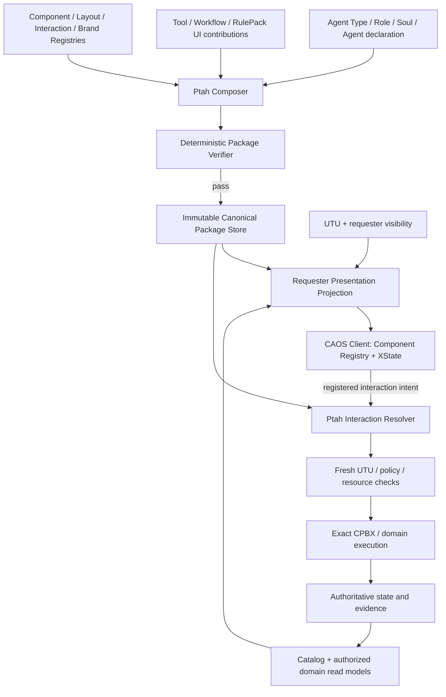

# CAOS — Realm of Ptah
## Backend-Driven Interface Composition and Integrity Architecture

**Document:** `docs/PTAH_REALM_ARCHITECTURE.md` (proposed repository location)  
**Version:** Architecture baseline 0.1  
**Date:** 2026-10-30  
**Status:** Approved direction with proposed interface contracts; **Ptah is not yet implemented**  
**Project:** CAOS — Cognitive Agentic Operative System / AOSA — Agent Oriented System Architecture  
**Authority:** Human architect owns architectural approval; examples in this document are illustrative, not current API schemas.  
**Evidence:** Architecture discussion, attached CAOS continuity and update documents, and user-reported implementation checkpoints; **not an independent source audit**.

> **Foundational principle:** Ptah determines which verified interface CAOS presents. The client renders it. UTU and CPBX independently determine what the requester may do. A GUI package is never a capability grant.

---

## 0. Executive decision record

### Approved architectural direction

1. **Ptah is a deterministic System Citizen** responsible for *Interface Composition and Integrity*, distinct from Genesis, the client and the Tool Registry.
2. **Backend-driven UI, not backend-executed UI.** Ptah publishes declarative, versioned component trees and registered interaction references; the browser uses trusted local React/shadcn components. No executable JavaScript, JSX, arbitrary HTML/CSS or runtime XState code arrives as package data.
3. **Two distinct products:** an immutable, verified, canonical interface package, and a fresh requester/tenant-specific **presentation projection** derived from it. User-specific projections are not canonical packages.
4. **Registered interactions are intents, not endpoints.** Client submissions contain resource/interface/component/interaction/package references plus validated input; the backend resolves server-private action bindings and rechecks live authority.
5. **Agent interface navigation:** one authorized interface renders directly; multiple interfaces use tabs. Enki defaults to **Agent Configuration** with **Conversation** as second tab. Thoth and Nabu initially use Conversation. Tab labels resolve by explicit declaration override → Component Registry label → deterministic type fallback.
6. **Tool UI contributions:** a Tool may offer dashboard, workspace, configuration and storefront/card contributions into compatible slots. Ptah decides composition; the Tool does not choose arbitrary page placement or obtain execution authority.
7. **Enki Tool Store:** a reusable, embedded **Tool Store widget within Enki's Agent Configuration tab** for selecting and configuring Tools for the *Agent being created*. It is not a separate mandatory store application and is not the list of Enki's own executable Tools.
8. **Reusable resource presentations:** Agent and Tool cards, info views, collection grids, avatars/icons and safe detail projections are first-class registered client components.
9. **XState v5 client interaction runtime:** use trusted, versioned client-side state machines for local UI orchestration. Backend still owns authoritative draft, Manuscript, G3.3/G3.4, operation and lifecycle state.
10. **Enki sigil:** Enki should automatically generate the Agent's initial visual sigil through separately governed Draw and asset facilities before final review, without an extra image-generation confirmation. This remains a **future, authority-sensitive feature**; Enki's existing proposal grant does not confer Draw or draft-write privileges.
11. **Develop Ptah before the major client rewrite.** Finish Catalog and Reasoning, integrate Enki's cognitive turn plan, build Ptah's contracts/composition, then pivot to CLIENT-1.0 as the backend-driven renderer.

### Scope labels

- **Implemented (as reported):** G3 strict `gui_components` declarations; Enki's existing V2 form and Conversation declaration; DRAFT-0.1/0.2 server-authoritative draft and human proposals; G3.3/G3.4 review/creation; `manuscript@1.0.0` first-class Tool and six scoped capabilities; `reasoning@1.0.0` optional cognitive Tool over Enki's scoped `cognitive.interpret@1.0.0` (REASONING-0.1C, uncommitted).
- **Approved design, not implemented:** Ptah System Citizen, canonical interface packages/projections, package-resolved interactions, client machine registry, Enki embedded Tool Store, Agent/Tool resource widgets, production Ptah tabs.
- **Future proposal requiring contracts/authority:** actual Draw-backed automatic sigil, Manuscript Designer, governed validation/publishing, universal Sandbox Tool, Workflow Studio and RulePack Designer, optional User Soul adaptive presentation.

---

## 1. Domain boundaries

| Domain | Owns | Must not own |
| --- | --- | --- |
| **Ptah** | UI registries, deterministic composition, package verification/publication, presentation projection, interaction binding resolution | Agent creation, grant issuance, private business state, LLM-generated executable UI |
| **Agent/Tool/Workflow registries** | Resource specifications, versions and approved UI contribution declarations | Granting a requester access by merely listing a resource |
| **Catalog (CATALOG-0.1 service accepted; CATALOG-0.1A Enki `catalog.project@1.0.0` implemented, uncommitted — [Catalog](CATALOG.md))** | Requester-scoped discoverability and reference resolution | Execution entitlements; trusting resource IDs from the browser |
| **UTU** | Identity, tenancy, policy, scoped permits, revocation and authorization | Visual presentation/layout |
| **CPBX** | Registered exact-version capability dispatch | Frontend routes or UI composition |
| **Genesis / G3.3 / G3.4** | Validation, review/approval, approved Agent creation | Building Ptah packages or creating sigils as an implicit side effect |
| **Manuscript** | Pinned protocols, typed interview answers, deterministic stage state | Rendering React, granting Tools or silently executing handoffs |
| **Enki** | Agent-composition conversation, bounded interpreted proposals, initiating already-governed processes | Unrestricted Store, direct approval, implicit activation or broad draft-writing |
| **Seshat** | Correlated evidence for consequential publication/interactions/decisions | Copying every UI keystroke or storing raw sensitive prompt data |
| **CAOS client** | Trusted component renderer, local interaction state, accessibility and responsive behavior | Interpreting backend packages as executable code or deciding server authority |

Ptah is an **OS-level UI compositor**, not a second Tool Registry and not a replacement for domain services. Its scope extends to Agents, standalone Tools and Workflows. A hosted UI is not proof that an operation is allowed.

---

## 2. Conceptual information flow



**Canonical packages** represent stable, publishable interface structure and binding references, not a freeze-dried snapshot of current Tools, private records, real-time availability or user permissions. Live data is projected separately on request. A change in avatar imagery, Tool catalog items or draft revision should not force republishing an otherwise unchanged package structure.

### Composition precedence (proposed)

1. Agent Type's approved default interface templates.
2. Role contributions, when supported by contract.
3. Tool/Workflow/RulePack contributions within declared compatible slots.
4. Agent-declared interface selection and overrides, within permitted constraints.
5. CAOS brand/design tokens and supported client capability manifest.
6. Requester projection: visibility, resource data and available presentation actions.

Precedence must be explicit and deterministic. Conflict resolution cannot silently discard required UI elements or allow a lower-priority contributor to override a security-critical component.

---

## 3. Ptah registries

### 3.1 Component Registry

Each versioned component type defines a public key, allowed props and data contracts, supported children/slots, accessibility requirements, permitted events and required renderer capability. Examples (proposed keys):

- `agent.card@1.0.0`, `agent.info@1.0.0`, `agent.avatar@1.0.0`;
- `tool.card@1.0.0`, `tool.info@1.0.0`, `tool.avatar@1.0.0`;
- `resource.grid@1.0.0`, `resource.details@1.0.0`;
- `catalog.tool_store@1.0.0` (Enki Tool Store);
- `manuscript.progress@1.0.0`, `manuscript.stage@1.0.0`;
- `draft.editor@1.0.0`, `draft.proposals@1.0.0`, `draft.review@1.0.0`.

These are **proposed component identities, not currently registered keys**. The key alone never denotes a provider or operation.

### 3.2 Layout Registry

Defines layouts (tabs, responsive grids, side panels, details, dashboards), named slots, allowed component families, maximum depth/node counts, ordering rules and responsive behavior. Tool contributions may target only approved slots and must be checked for size/parent-child compatibility. Accessibility and mobile overflow are mandatory verification concerns.

### 3.3 Interaction Registry

Maps public, versioned **interaction IDs** to server-private handler/binding contracts. Example interaction types: open Tool detail, select Tool, save draft, accept proposal, request G3.3 review, initiate G3.4 create. Package validation checks that every visible actionable component references an existing interaction contract with typed input and a compatible source binding. A component cannot embed an HTTP endpoint or CPBX signal as executable metadata.

### 3.4 Brand Registry

Start with one native CAOS dark theme with semantic color, typography, spacing and icon tokens. Branding and accessibility contrast remain controlled by registered tokens rather than user/Tool-injected CSS. Future per-user preference projection is opt-in and separate from policy or authorization.

### 3.5 Client Capability Manifest

The client advertises registered component and interaction-pattern versions it can render. Ptah rejects or deliberately degrades unsupported required components; it must not silently render an unsafe unknown component or inject new JavaScript. Exact manifest transport/version negotiation remains to be designed in PTAH-0.1.

---

## 4. Canonical interface package and requester projection

### 4.1 Canonical package (illustrative, *not* an API contract)

```json
{
  "contract": "caos.ui.package.v1",
  "package_key": "agent.enki.workspace",
  "revision": "immutable-package-revision",
  "owner_resource": {"kind": "agent", "id": "enki"},
  "interfaces": [
    {"key": "agent_configuration", "component": "layout.form@1.0.0", "default": true},
    {"key": "conversation", "component": "layout.conversation@1.0.0"}
  ],
  "components": [
    {"key": "agent_tools", "type": "catalog.tool_store@1.0.0", "slot": "agent_configuration.tools"}
  ],
  "interaction_refs": ["draft.save@1.0.0", "draft.review@1.0.0"],
  "dependency_fingerprints": {},
  "fingerprint": "sha256:..."
}
```

Canonical package storage is append-only for verified, published artifacts. Publication must detect dependency drift and content-fingerprint collisions. Package revisions are immutable; new composition creates a new revision. Store server-private interaction manifests and binding details separately from browser presentation payloads.

### 4.2 Requester projection

Request-time projection derives only what the authenticated human is allowed to see, based on authoritative visibility and approved server data sources. It may hide a Tool or action but must never treat hiding as an execution guard. It can be cached under strong tenant/requester/policy/dependency keys, with invalidation on relevant changes. **Recheck authorization upon actual interaction execution regardless of cached projection freshness.**

Do not publish user-scoped projections as canonical packages; avoid cross-tenant cache leakage. A lightweight listing descriptor and a full on-demand package serve different use cases.

---

## 5. Backend interaction contract and trust boundary

### 5.1 Client request envelope (illustrative)

```json
{
  "agent_id": "agent-id",
  "interface_key": "agent_configuration",
  "component_key": "agent_tools",
  "interaction_key": "tool.select",
  "package_revision": "published-revision",
  "input": {"tool_key": "manuscript", "config": {"default_manuscript": "agent_creation_interview@1.0.0"}}
}
```

The browser supplies **intent**, never its own trusted handler, permit, URL, provider, executable state machine, role or tenant. The server must:

1. Re-establish human/requester context from a verified authenticated session.
2. Resolve package identity and revision from its canonical published record, reject unknown/stale/inapplicable interactions.
3. Resolve `interface_key`, `component_key`, `interaction_key` against a **server-private** verified binding; reject mismatched component or unauthorized interaction context.
4. Validate input against the registered strict schema and resource-specific constraints.
5. Recheck current resource visibility, state (e.g., approved draft frozen) and UTU policy/permits.
6. Invoke the authorized exact-version CPBX/domain operation, with idempotency and authoritative CAS where applicable.
7. Return a bounded typed result, not raw sensitive Store/provider data.
8. Record consequential evidence through the existing Seshat taxonomy; do not create raw prompt/keystroke logs.

**Non-negotiable:** tool discoverability, Tool attachment, definition visibility and current execution permission are **four separate decisions**. None implies another.

### 5.2 Existing legacy bridges

Current Enki V2 form calls some V1 registry read APIs. Ptah/CATALOG-0.1 should migrate those carefully to governed V2 projections without changing G3.3/G3.4 authority. The presence of `/api/v1` reads does not imply V2 draft endpoints are operational.

---

## 6. Navigation and reusable Agent surfaces

### Agent interface navigation (approved ADR-0003 direction)

- Exactly one requester-authorized interface: render directly without tabs.
- Multiple authorized interfaces: render in declared order using tabs.
- Enki: default **Agent Configuration**, second **Conversation**; both share the same authoritative creation draft.
- Thoth and Nabu: initially Conversation only.
- Tab label precedence: per-declaration optional label override → Component Registry default → deterministic type fallback (`agent_configuration` → “Agent Configuration”). Explicit schema migrations must retain strict `extra='forbid'`.
- Preserve local unsaved state when switching tabs; restoring a tab from URL state is optional. Unauthorized/invalid tab falls back to authorized default/first.
- A tab itself does not grant the underlying operation.

### Resource widgets

`agent.card` displays projected identity, avatar/sigil, safe summary, Role/Soul and lifecycle status; `agent.info` supplies authorized detail. `tool.card`/`tool.info` display description, version, compatibility, configuration and publisher metadata appropriate to the requester. Lists use `resource.grid` or equivalent registered collections. The same component should work in JOSHUA's overview, Enki's creation flow and future Studio apps without hardcoding each page.

Resource data binds to current authorized catalog/read models, not baked canonical package snapshots. Loading, empty, denied, stale and error states should be explicit and accessible.

---

## 7. Enki's embedded Tool Store

**Product placement is settled:** the Tool Store is a **widget inside Enki's Agent Configuration interface**, not a separate required store destination. It selects/configures Tools for the candidate Agent, **not** Enki's personal execution grants.

### Widget contract (illustrative)

```json
{
  "component": "catalog.tool_store@1.0.0",
  "slot": "agent_configuration.tools",
  "props": {"mode": "agent_composition", "selection": "multiple", "configurable": true},
  "data_binding": "catalog.tools.eligible_for_candidate@1.0.0",
  "interaction_refs": ["tool.inspect@1.0.0", "draft.tool_selection.propose_or_save@1.0.0"]
}
```

The binding and interaction keys above are placeholders for PTAH/CATALOG contract design. **Do not treat them as existing signals.** CATALOG-0.1 provides the data contract such a binding would project (`caos.catalog.list` with a candidate and `compatible_only`; entries carry separate compatibility, attachment and a fixed `execution_authorization: not_evaluated`) — see [Catalog §4](CATALOG.md). Compatibility is advisory (`compatible` is unconditional; `conditional` marks an incomplete candidate) and G3.3 stays authoritative. No Ptah binding, human projection route or component is implemented; Enki's `catalog.project` is an Agent capability, not a browser API.

Tool configuration fields may carry descriptive `options` (`value`, `label`, `description`; REASONING-0.1C). The `reasoning` Tool uses them for its `tasks` multiselect: the store can show each published task's title and description, never prompts, schemas or models. Selecting tasks changes only the candidate's `AgentToolRef.config`; it grants no execution.

### User journey

1. Enki Agent Configuration opens a requester-scoped list of discoverable, compatible Tools.
2. Tool cards show identity/icon, version, description, safe compatibility status and configuration entry point.
3. Selecting a Tool opens its schema-driven configuration widget, optionally including a registered Tool preview/storefront contribution.
4. Human saves through the DRAFT-0.2B human-authorized revision/CAS flow; an Enki conversational suggestion instead uses `agent.draft.propose@1.0.0` plus explicit human acceptance.
5. G3.3 validates and reviews the resulting candidate; G3.4 creates a sleeping Agent with the approved Tool configuration.

**No Tool selection grants UTU execution rights.** Store UI must distinguish *discoverable*, *configurable/compatible*, *attached to candidate* and *executable by a particular Agent now*. Current candidate config may include Tools without execution grants; the UI should not misrepresent this as operational readiness.

### Tool-contributed UI

A Tool may optionally publish metadata for:

- **Dashboard widget:** compact status/progress in an authorized Agent workspace.
- **Workspace panel:** deeper Tool-specific interaction view.
- **Configuration widget:** typed config controls within Agent/Workflow composition.
- **Storefront widget:** Tool preview/details inside Enki's embedded Tool Store.

Ptah validates allowed slots and renders through registered components only. Tool metadata cannot insert executable URLs, arbitrary CSS, unregistered React, or privileged CPBX calls. A Tool need not expose all four contribution types.

---

## 8. Visual identity, avatar and Enki's sigil

### Resource identity

- Agents have an initial avatar/sigil; Tools have a publisher-provided icon or approved asset. Manuscripts, Workflows and RulePacks may also have approved icons in later versions.
- Media is stored in a governed asset service by immutable references, not as image blobs in Agent documents or canonical UI package definitions.
- Projection resolves signed/authorized asset presentation for the requester; fallback icons always work when media is absent.
- Asset ownership, tenancy, provenance, size/format validation, lifecycle and retention must be specified before implementation.
- **CATALOG-0.1 (implemented, uncommitted):** catalog entries carry a deterministic `fallback_icon` (kind glyph, monogram, hue from SHA-256 of `kind:key`) and a reserved `media` asset reference that is always empty; no avatar, sigil or asset is generated or stored ([Catalog §4](CATALOG.md)).

### Automatic initial sigil — approved intent, implementation **pending**

1. Enki's bounded creation flow collects candidate name/purpose/Role/Soul.
2. It automatically requests a first sigil from a separately scoped **Draw** capability, without a standalone confirmation prompt.
3. A governed asset service validates and stores the generated candidate image; idempotency keyed by candidate + relevant identity digest prevents repeated charge on refresh/retry.
4. An explicitly reviewed, **narrow** authority allows the verified asset reference to become part of the candidate **before G3.3 review**; this must not confer Enki general draft-write rights.
5. Human approval covers the complete candidate, including its sigil reference; Genesis persists an approved sleeping Agent; Khepri activation remains separate.
6. A later avatar revision must not rewrite the initial creation provenance or invalidate unrelated Ptah package revisions.

Open design work: Draw provider scope and costs, asset retention/orphans, failures/retries, input safety/content policy, field mapping in `AgentCreationInput`, and whether sigil generation failure blocks review or yields a verified fallback. Do not silently add Draw grants or alter Agent creation schemas in PTAH-0.1.

---

## 9. XState v5: trusted local interaction machines

XState belongs in the **client**, as a UI interaction runtime. It is not the Manuscript stage engine, Workflow Engine, Genesis creation state machine or OPS V2 authoritative state.

### Candidate registered machines (proposed)

| Client pattern | Local responsibilities | Authoritative source |
| --- | --- | --- |
| `draft.editor@1.0.0` | Loading, unsaved edits, focus refresh, field conflict UI, retries | DRAFT Service revision/CAS |
| `proposal.review@1.0.0` | Selection, confirmation, pending/rejected UI | Proposal Service decision |
| `manuscript.interview@1.0.0` | Loading, submitting typed answers, displaying errors | Manuscript session revision |
| `agent.creation@1.0.0` | Request pending, success/failure, button disabling | G3.3/G3.4 outcome |
| `catalog.selector@1.0.0` | Search, filters, modal open, unsaved Tool config | Authorized Catalog and draft |
| `sandbox.execution@1.0.0` | Future scenario status and result presentation | Future Sandbox runtime |

Ptah references only **registered public interaction pattern IDs**. It cannot transmit custom XState logic, scripts or expressions for the client to execute. Machine internals can change without republishing Ptah packages if the public versioned contract remains compatible. On page reload the client rehydrates from authoritative server state; local-machine transitions never imply an approval or committed Agent creation. Consider typed actors, cancellation, retries and server event reconciliation.

Accessibility and focus behavior should be validated alongside state transitions. A race between saved and unsaved data must not silently overwrite human input.

---

## 10. Validation, verification and publication

Before Ptah publishes a canonical package, it must deterministically verify:

- Schema/contract validity; strict unknown-field handling.
- Every referenced component/layout/interaction/brand version exists.
- Allowed nesting, depth, count, slot placement, ordering, responsive and accessibility invariants.
- All interaction bindings are registered, compatible and resolve on the server; no injected URL/JS/handler/provider.
- Resource contribution provenance and dependency fingerprints.
- Renderer capability compatibility and known degradations.
- No illegal cross-tenant data or mutable user-specific projections frozen into the canonical package.
- Canonical fingerprint integrity and append-only version publication.

Passing package validation does **not** prove user experience quality or grant execution permission. Testing should include human usability, keyboard access, screen-reader semantics, mobile layouts and real requester projections. Optional future Sandbox Tool may rehearse UI interactions with fake identities and isolated capabilities, but will not substitute for current UTU enforcement.

Seshat should record meaningful publication and consequential interaction outcomes with IDs, hashes and causation, never raw sensitive UI state by default.

---

## 11. Implementation phases and gates

### PTAH-0.0 — Discovery / architecture contract sign-off

- Inspect existing `gui_components`, AgentComposer, registries, ToolSpec/Synaptic specs, `resource_exposure`, requester manifest projections, available shadcn UI and G3 API routes.
- Produce executable contract draft, dependency inventory, compatibility matrix and ADRs for package/projection separation, Tool UI contributions and XState.
- Avoid creating unrelated new permissions or broad trusted lines.

### PTAH-0.1 — Backend core

- Component/Layout/Interaction/Brand registry contracts (minimum brand variant).
- Deterministic composer and bounded verifier, canonical package fingerprint and append-only publication.
- Server-private authoritative interaction manifest and requester-aware presentation projection.
- Minimal safe Tool UI contribution metadata and Client Capability Manifest compatibility.
- Tests for malicious/unregistered components, stale packages, binding substitution, tenant isolation, deterministic output and no implicit grants.

### PTAH-0.2 — Enki reference package

- Compose Enki's Agent Configuration and Conversation surfaces, including approved tab rules and labels.
- Declare embedded Tool Store, Agent/Tool cards, basic Manuscript progress and draft review components; make projected catalog data dynamic.
- Server interaction resolution must use existing DRAFT/Manuscript/G3 authority (never bypass it).
- Respect the current client renderer's limited capabilities; implement only the smallest compatibility adapter needed to exercise package contracts, not a broad client redesign.

### CLIENT-1.0 — Backend-driven client pivot, after Ptah

- Adopt trusted component registry and XState v5.
- Render Ptah packages rather than hardcoded per-Agent pages.
- Ship Enki embedded Tool Store and reusable Agent/Tool cards and avatar fallbacks.
- Preserve current human-owned unsaved edits and G3.3/G3.4 behavior.
- Verify actual backend-driven Enki experience end to end, with progressive feature migration from legacy V1 routes.

### Later integrations (not blockers for Ptah core)

- Enki Draw-backed initial sigils and asset pipeline, with separately approved scope.
- Manuscript Designer and governed publication; Sandbox Tool; Workflow/RulePack studios.
- Future user-controlled preference projection and accessible adaptive layout research.

**Interaction boundary for Enki's conversation-to-draft turn (proposed, design only):**
`enki.conversation.submit@1.0.0` and `draft.proposal.decide@1.0.0`, resolved server-side to
the existing V2 dispatcher/Enki turn coordinator and the human-only DRAFT-0.2A decision
service — see [REASONING-0.1 §4](REASONING_0_1_ARCHITECTURE.md). Not registered.

**Milestone sequence as currently agreed:** CATALOG-0.1 → REASONING-0.1 → ENKI-1.0-B → PTAH-0.1/0.2 → CLIENT-1.0. Design Ptah's interaction boundary before implementing ENKI-1.0-B. Engineering may revisit ordering only by explicit architectural review.

---

## 12. Acceptance criteria for the first Ptah-driven Enki experience

1. A canonical Enki package reproduces the same fingerprint given identical registries and dependency inputs; a changed dependency is detected before publication or invocation.
2. Enki's two authorized interfaces display as tabs in declared order, Agent Configuration selected by default; a one-interface Agent renders without tab chrome.
3. The embedded Tool Store uses live requester-scoped Tool Catalog projection; adding a Tool changes the candidate draft only through authorized CAS and does not grant execution.
4. Agent cards and Tool cards reuse registered components and display authorized, safe metadata with deterministic fallback icons.
5. User-specific visibility changes do not alter canonical package identity and do not leak tenant data through projection/cache.
6. An unauthorized or stale UI interaction is rejected on the server despite a cached visible button.
7. No client payload may name an executable CPBX signal, handler URL, tenant, owner or privileged provider binding as authority.
8. Existing Enki unsaved edits, field-level conflicts, proposal acceptance, G3.3 review digest and G3.4 creation remain correct.
9. A malicious Tool UI contribution fails verification instead of rendering executable content.
10. XState handles loading/errors/retries as UI state only; it cannot claim Agent creation from local transitions.
11. Neither Ptah package publication nor UI delivery creates Agents, grants permissions, activates Agents or writes live Agent drafts.
12. No avatar/sigil grant is introduced implicitly; if later enabled, the sigil is part of an approved candidate and its asset is governed independently.

---

## 13. Current environment integration issue (confirmed, unrelated to Ptah architecture)

On 2026-10-30 the Enki V2 page at `http://localhost:4000/v2/forms/00000000-0000-4000-8000-000000000004` displayed **“Draft service unavailable (HTTP 503)”**.

A subsequent read-only OpenCode diagnosis established that the **Next.js proxy** generated this 503 before any FastAPI request: the server-only `GENESIS_AGENTS_URL` environment setting was absent. `proxyAgentDrafts()` in `caos-client/src/shared/auth/lib/agent-drafts.ts` returned `{"error":"Server drafts are disabled"}`; the client converted this to its generic 503 notice. The FastAPI draft routes are registered; this was **not** evidence of an unimplemented Draft Service.

Proposed minimal local configuration (not yet confirmed applied):

```dotenv
# caos-client/.env.local — server-side only
GENESIS_AGENTS_URL=http://127.0.0.1:8001/api/v2/agentverse/agents
```

Confirm the actual FastAPI port/address and restart only Next.js after safeguarding local unsaved form edits. Do not publish this setting to browser-exposed `NEXT_PUBLIC_*` variables. Preserve existing intentionally uncommitted client `next.config.mjs`/`LandingPageBody.tsx` and API `.gitignore` changes. Future Ptah work should not hide transport/config errors behind generic “service unavailable” if diagnostics can safely distinguish them.

---

## 14. Continuity and source of truth

### Last reported pushed checkpoints

- `caos-api`: `feature/ops-v2` → `origin/feature/ops-v2`; `e076639`, `feat(caos): checkpoint governed drafts and manuscript tools`.
- `caos-client`: `master` → `origin/master`; `0a03280`, `feat(enki): integrate server-authoritative agent drafts`.
- Local deliberately uncommitted at checkpoint: API `.gitignore`; client `next.config.mjs` and `src/app/(workspace)/_components/LandingPageBody.tsx`.
- Reported baseline: API 2,672 passed/9 skipped/5 inherited signing-key failures; client 1,365 passed/33 inherited failures; additional backend lint/format/mypy technical debt documented separately. Do not claim a fully clean baseline.

### Related architecture references

- `docs/ENKI_1_0_ARCHITECTURE.md` — Enki workflow, GUI declarations, review/creation and Ptah interaction decisions.
- `docs/architecture/decisions/ADR-0003*` — navigation decision; **actual directory is `docs/architecture/decisions/`, not `docs/adr/`**.
- `docs/MANUSCRIPTS.md` — versioned Manuscript Registry/Tool and six governed session operations.
- `docs/AGENT_DRAFTS.md` — server drafts, proposals, review and lifecycle.
- `docs/architecture/IMPLEMENTATION_STATUS.md` and `docs/architecture/HANDOFF.md` — operational continuity.
- `CAOS_ARCHITECTURE_AND_CONTINUITY_2026-10-30.md`, `CAOS_ARCHITECTURE_UPDATE_2026-10-30.md` — conversation-level historical sources; some older sections predate implemented milestones.

**Repository integration guidance:** Place this file at `caos-api/docs/PTAH_REALM_ARCHITECTURE.md` after reviewing actual existing docs; link it from the architecture index, ENKI-1.0 architecture and handoff. Do not silently overwrite a conflicting ADR or describe planned Ptah features as code that exists. Preserve Git state and request explicit approval for commits or policy/grant changes.

---

## 15. Open architectural questions to resolve before Ptah implementation

1. Exact canonical package schema, revision identity, publication storage backend and dependency invalidation strategy.
2. Interaction Registry schema, strict typed inputs, package-revision freshness and server-private manifest retrieval.
3. Existing component registry overlap, frontend capability negotiation and controlled version migrations.
4. Tool UI contribution ownership, compatibility enforcement, layout conflict rules and contribution precedence.
5. Catalog data-binding syntax and query isolation; how to distinguish public Tool descriptors from requester-authorized configuration choices.
6. Resource asset storage, safe URL projection, avatar inheritance and Tool publisher icon verification.
7. Enki sigil field/asset contract and the limited automation authority for verified system-generated draft references.
8. XState public interaction pattern versioning and actor/service integration with server push or polling.
9. Seshat taxonomy for Ptah package publication and consequential actions, without duplicating ordinary draft edit history.
10. Accessibility and usability acceptance methodology beyond schema integrity.

**Decision discipline:** unresolved schema details require repository inspection and explicit architectural review; examples above are design targets, not authorization to introduce new signals, grants, live DB writes or executable UI payloads.
